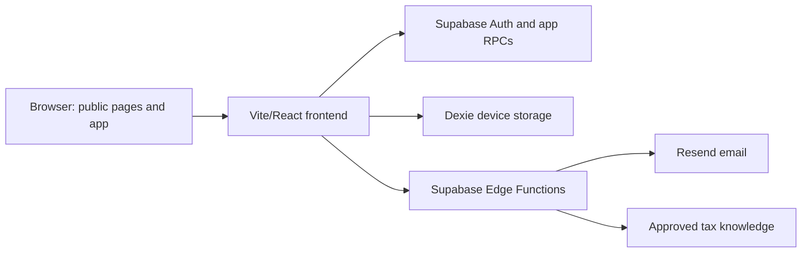

# FileSmart project handoff

## Executive summary and goals

FileSmart helps individuals prepare personal income tax information in Nigeria. The current app includes authenticated preparation, a tax estimator, source-aware deadlines, receipt review, and universal PDF/CSV/XLSX preparation exports. Those exports are **not** evidence of electronic filing with a tax authority. The public website explains the product, hosts tax education, collects launch interest, and provides support contact.

The immediate integration goal is to bring the fuller public website into the canonical app repository without reverting the app's Supabase authentication or 2026 Nigeria Tax Act calculation. `codex/filesmart-integration-20261025` is an integration branch; production deployment requires a separate review after all release gates pass.

## Architecture and data flow



| Area | Location | Role |
| --- | --- | --- |
| Public routes | `src/App.tsx`, `src/pages/{Landing,Learn,Guide,About,HowItWorks,Contact,Pricing,FilingWaitlist}.tsx` | Marketing, education, contact, waitlist, account-gated pricing. |
| Shared public UI | `src/components/public/` | Navigation, footer, support assistant. |
| Tax law and calculation | `src/lib/tax-calculator.ts`, `src/lib/calculation-service.ts`, `src/data/pit-baseline.ts` | 2026-and-later PIT estimates; ambiguous inputs withhold a number. |
| Tax education | `src/content/tax-guides.ts` | Reviewed article records and source links. |
| Auth and persistence | `src/contexts/AuthContext.tsx`, `src/lib/supabase-client.ts`, `src/lib/db.ts` | Supabase account state plus on-device data. |
| Database and functions | `supabase/migrations/`, `supabase/functions/` | Waitlist RPC, contact email, support assistant, rate limits. |
| Brand and media | `public/brand/`, `public/images/` | FileSmart marks and licensed/generated website media. |

## Environments and setup

Use Node.js and npm compatible with `package-lock.json`; the verified local workflow is `npm ci`, then copy `.env.example` to `.env` and fill only the public Supabase URL and anon key. Do not commit `.env`. The source is Vite/React/TypeScript with Tailwind, Supabase, and Dexie.

| Variable | Where | Purpose |
| --- | --- | --- |
| `VITE_SUPABASE_URL`, `VITE_SUPABASE_ANON_KEY` | Frontend build | Public Supabase project connection; values come from Supabase Project Settings → API. |
| `VITE_FILING_LAUNCH_PHASE` | Frontend build | Set `true` for the public launch website; use `false` for the app demo. |
| `VITE_PUBLIC_SITE_URL` | Frontend build | Canonical public URL; use `https://www.filesmartnaija.com`. |
| `APP_ORIGIN` | Supabase Edge Functions | Exact HTTPS origin allowed by existing CORS handlers. Verify this matches the caller before release. |
| `CONTACT_APP_ORIGIN` | Contact Edge Function | Optional exact HTTPS public-site origin, independently of the app's `APP_ORIGIN`; set to `https://www.filesmartnaija.com` for the website. |
| `LAUNCH_RESEND_API_KEY`, `LAUNCH_EMAIL_FROM` | Supabase Edge Functions | Restricted Resend sender for contact and launch email. |
| `RATE_LIMIT_SALT`, `SUPABASE_SERVICE_ROLE_KEY` | Supabase Edge Functions | Private rate limits and server-only database access. Never expose as `VITE_*`. |
| `LLM_API_URL`, `LLM_API_KEY`, `LLM_MODEL`, `LLM_ALLOWED_HOSTS` | Support Edge Function | Server-side tax support provider. |

The full public feature controls and optional OCR values are listed in `.env.example`. Do not assume that local Supabase CLI migrations or Edge Functions have been deployed remotely merely because the files exist here.

## Standard workflow and release gates

```powershell
npm ci
npm run dev
npx tsc -p tsconfig.app.json --noEmit
npm run lint
npm test
npm run build
```

The local test environment requires public placeholder `VITE_SUPABASE_URL` and `VITE_SUPABASE_ANON_KEY` values even for some mocked UI tests. Never substitute a service-role key. Edge Function tests using `Deno.test` require the Deno runner; Vitest is for `src/` tests and Vitest-authored function tests.

Before release, verify on the intended target: public navigation and article links, mobile layout, Supabase account creation/login, authenticated pricing, launch waitlist consent and persistence, contact email delivery, 2026 tax examples and withheld-estimate states, exports, and no private data exposed in browser logs. Apply only reviewed migrations. Set and verify `CONTACT_APP_ORIGIN` for the public site's contact function. The support and auth Edge handlers still use exact `APP_ORIGIN`; verify their intended host independently before shipping both surfaces.

The public website lives at `https://www.filesmartnaija.com/` (Cloudflare). The app demo lives at `https://filesmart-demo.netlify.app/` (Netlify). Keep the app demo on the canonical app code. Do not deploy this integration branch to either target until route, test, and function checks pass and the site-specific environment is reviewed.

The pricing route currently requires an account in the UI, but its plan data is compiled into a public JavaScript chunk. This is a discovery gate, not confidential storage. If pricing must be inaccessible before authentication even to a technical visitor, move plan data behind an authenticated server endpoint before release.

The current Vite build also emits app route chunks alongside the public website. A visitor can inspect those assets even while the launch waitlist hides filing controls. Because FileSmart's filing workflow is intended to stay private until tax season, do not publish this combined build to Cloudflare as the final website artifact. Create a separate public-only build that excludes filing components and private pricing data, and independently verify its output before a website release. The Netlify app demo may continue using the combined app build for its authorized audience.

## Dependencies and maintenance

Operational dependencies are Supabase Auth/database/Edge Functions, Resend for email, and the configured server-side LLM provider for tax support. See `docs/filesmart-phase-one-operations.md` and `docs/launch-waitlist-notifications.md` for existing operating notes. The repository README contains old Lovable setup text; this handoff is the current integration record.

If the waitlist fails, first check the `join_launch_waitlist` migration, Supabase public keys, CORS origin, and function logs. If contact fails, check the exact origin, contact Edge Function deployment, Resend sender verification, function secrets, and rate-limit RPC. If the app appears to be the website (or vice versa), check the deployment project's repository/ref and `VITE_FILING_LAUNCH_PHASE` value.

Update this file whenever routes, deployment targets, environment names, tax calculation rules, migrations, or operational ownership change. Require tax professional review of the legal interpretations and public education copy before a production tax-calculation release.

## Recommended next improvements

- Add a server-side filing submission lock before any submission API is introduced; the current launch flag controls only frontend navigation.
- Give each frontend host a reviewed exact-origin policy for Edge Function requests and test both hosts after deployment.
- Replace old Lovable README setup claims after integration is approved, so contributors have a single current entry point.
